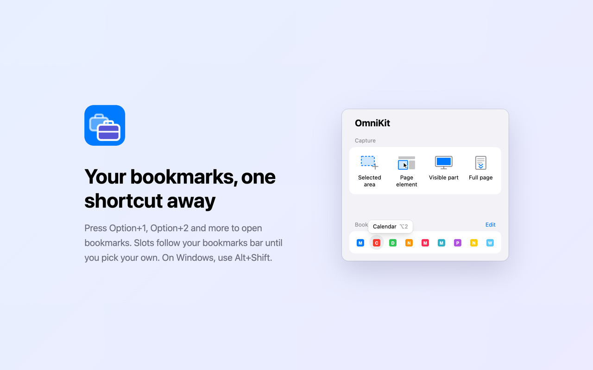

# OmniKit

[English](../README.md) | [한국어](README.ko.md) | [日本語](README.ja.md) | [简体中文](README.zh-CN.md) | [繁體中文](README.zh-TW.md) | [Español](README.es.md) | [Português (Brasil)](README.pt-BR.md) | [Deutsch](README.de.md) | [Français](README.fr.md) | [Bahasa Indonesia](README.id.md) | [Tiếng Việt](README.vi.md) | [हिन्दी](README.hi.md) | **العربية**

إضافة Chrome تجمع أدوات مفيدة للاستخدام اليومي في مكان واحد. متوفرة بـ 13 لغة.



## الميزات

### اختصارات الإشارات المرجعية

- فتح 9 خانات للإشارات المرجعية في علامة تبويب جديدة باستخدام اختصارات لوحة المفاتيح
- اختر إشارة مرجعية لكل خانة، أو اتركها فارغة لاستخدام الإشارة المرجعية في الترتيب نفسه في شريط الإشارات المرجعية
- إذا كانت علامة تبويب بالعنوان نفسه مفتوحة بالفعل، يتم الانتقال إليها
- الاختصارات الافتراضية للخانات من 1 إلى 4 (على Mac مفتاح Option مع رقم، وعلى غيره Alt+Shift مع رقم). يمكن ضبط الخانات من 5 إلى 9 في `chrome://extensions/shortcuts`

### التقاط

- 4 طرق: المنطقة المحددة، عنصر في الصفحة، الجزء المرئي، الصفحة كاملة (النافذة المنبثقة وقائمة النقر بزر الماوس الأيمن)
- يتم التقاط الصفحة كاملة والعناصر الطويلة أثناء التمرير ثم دمجها، مع إخفاء الترويسات الثابتة
- التعديل في المحرر باستخدام نص، سهم، قلم، شكل، فسيفساء، تمويه، رمز، اقتصاص
- التنزيل بصيغة PNG أو JPEG أو WebP، أو النسخ إلى الحافظة


## الخصوصية

- لا يتم إرسال أي بيانات إلى خوادم خارجية
- تُحفظ اللقطات في متصفح هذا الكمبيوتر فقط وتُحذف عند إغلاق علامة تبويب المحرر
- يقتصر إذن الالتقاط على علامة التبويب التي نقرت فيها على رمز شريط الأدوات أو قائمة النقر بزر الماوس الأيمن (`activeTab`)

## البناء من المصدر

يتطلب Node.js 20.19 أو أحدث

```sh
npm install
npm run build
```

1. افتح `chrome://extensions` في Chrome
2. فعّل وضع مطور البرامج
3. انقر على تحميل الإضافة غير المضغوطة واختر مجلد `dist`

| الأمر | الوصف |
|---|---|
| `npm run dev` | خادم التطوير |
| `npm run check` | فحص الأنواع والاختبارات والبناء |
| `npm run package` | إنشاء ملف zip لسوق Chrome الإلكتروني |

## التقنيات

Manifest V3, Vite, CRXJS, React 19, Tailwind CSS 4, TypeScript, Konva, Vitest

## الترخيص

[MIT](../LICENSE)

تراخيص المكتبات المضمنة (konva وreact-konva وLucide) موجودة في [public/THIRD_PARTY_NOTICES.txt](../public/THIRD_PARTY_NOTICES.txt)
