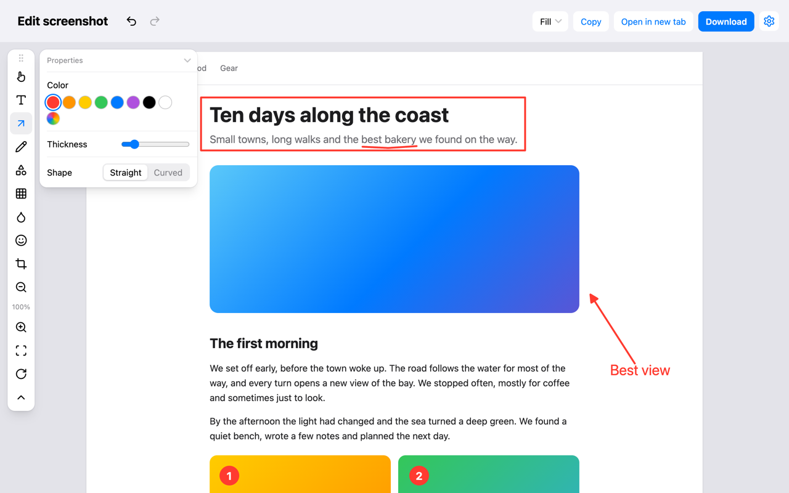

# OmniKit

[English](../README.md) | [한국어](README.ko.md) | [日本語](README.ja.md) | [简体中文](README.zh-CN.md) | [繁體中文](README.zh-TW.md) | [Español](README.es.md) | **Português (Brasil)** | [Deutsch](README.de.md) | [Français](README.fr.md) | [Bahasa Indonesia](README.id.md) | [Tiếng Việt](README.vi.md) | [हिन्दी](README.hi.md) | [العربية](README.ar.md)

Extensão do Chrome que reúne ferramentas úteis para o dia a dia. Disponível em 13 idiomas.

[Instalar pela Chrome Web Store](https://chromewebstore.google.com/detail/lfjjclkojbgjgjbjjpfippbjbemjmoci)


## Recursos

### Atalhos de favoritos

- Abra 9 espaços de favoritos em uma nova guia com atalhos de teclado
- Escolha um favorito para cada espaço ou deixe vazio para usar o favorito na mesma posição da barra de favoritos
- Se uma guia com o mesmo endereço já estiver aberta, muda para essa guia
- Atalhos padrão para os espaços 1 a 4 (Option+número no Mac, Alt+Shift+número nos outros sistemas). Os espaços 5 a 9 são definidos em `chrome://extensions/shortcuts`

### Captura

- 4 modos: Área selecionada, Elemento da página, Parte visível e Página inteira (pop-up e menu de contexto)
- Páginas inteiras e elementos longos são capturados enquanto a página rola e unidos em uma só imagem, com os cabeçalhos fixos ocultos
- Edite no editor com Texto, Seta, Caneta, Forma, Mosaico, Desfoque, Ícone e Cortar
- Baixe em PNG, JPEG ou WebP, ou copie para a área de transferência



## Privacidade

- Nenhum dado é enviado para servidores externos
- As capturas ficam salvas apenas no navegador deste computador e são excluídas ao fechar a guia do editor
- A permissão de captura vale apenas para a guia em que você clicou no ícone da barra de ferramentas ou no menu de contexto (`activeTab`)

## Compilar a partir do código-fonte

Requer Node.js 20.19 ou mais recente

```sh
npm install
npm run build
```

1. Abra `chrome://extensions` no Chrome
2. Ative o Modo do desenvolvedor
3. Clique em Carregar sem compactação e selecione a pasta `dist`

| Comando | Descrição |
|---|---|
| `npm run dev` | Servidor de desenvolvimento |
| `npm run check` | Verificação de tipos, testes e build |
| `npm run package` | Cria o zip para a Chrome Web Store |

## Tecnologia

Manifest V3, Vite, CRXJS, React 19, Tailwind CSS 4, TypeScript, Konva, Vitest

## Licença

[MIT](../LICENSE)

As licenças das bibliotecas incluídas (konva, react-konva, Lucide) estão em [public/THIRD_PARTY_NOTICES.txt](../public/THIRD_PARTY_NOTICES.txt)
